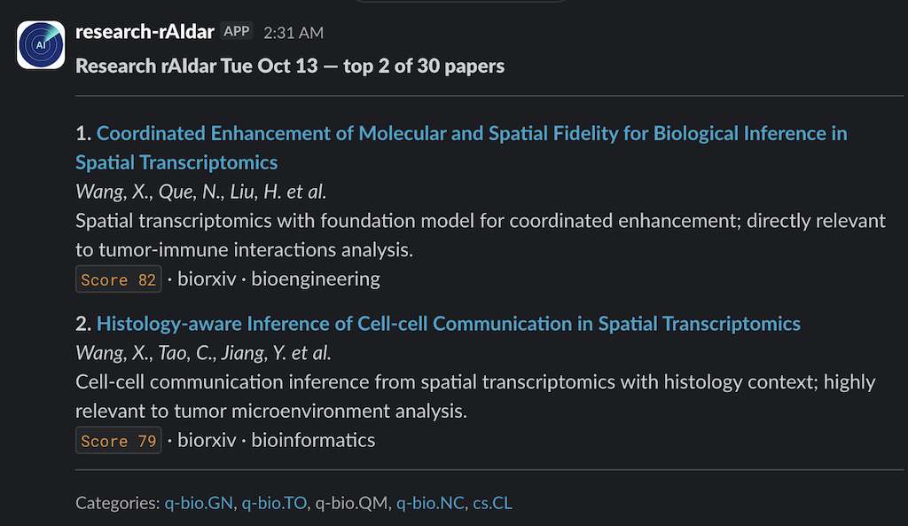
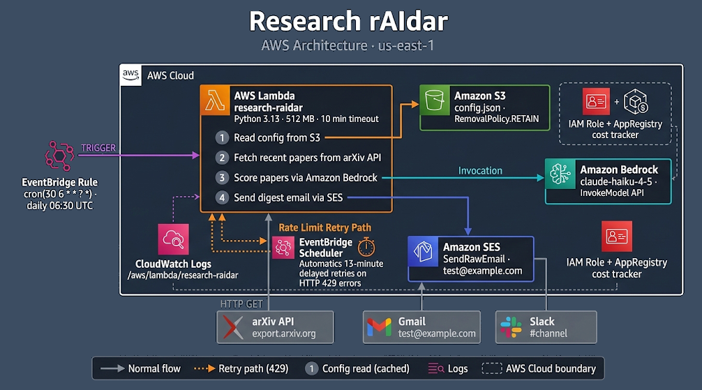

#  Research rAIdar: AI-Powered Research Intelligence 

---

## Introduction / Vision

Researchers, engineers, students, and curious professionals face a relentless challenge: **arXiv publishes hundreds of new papers every single day**, spanning physics, mathematics, computer science, economics, and beyond — and **bioRxiv and medRxiv** add thousands more across the life sciences. Staying current is a full-time job that nobody has time for.

The traditional solution (subscribing to email digests) delivers raw, unsorted paper lists with no sense of relevance to *your* specific interests. You either skim past papers that matter, or waste thirty minutes reading abstracts that don't.

**Research rAIdar** solves this with a fully serverless, AI-powered pipeline that wakes up every morning, fetches the latest papers from arXiv, bioRxiv, and medRxiv, scores each one against *your* research interests using Claude on Amazon Bedrock, and delivers a ranked, beautifully formatted digest to your inbox and Slack, all for less than 50 cents a month.

> *"Stop reading what's new. Start reading what matters."*

---

## Solution Overview

Research rAIdar is a **personal research intelligence assistant**: configurable, fully automated, and zero-maintenance once deployed.

Each morning at 06:30 UTC (after arXiv's nightly submission processing), the pipeline:

1. **Fetches** up to 80 recent papers from your chosen arXiv categories (genomics, AI, quantitative biology, or any of arXiv's 150+ subject areas) and up to 40 from bioRxiv/medRxiv
2. **Scores** every abstract against your stated research interests using Claude Haiku via Amazon Bedrock, rated 1–100 for relevance with a one-sentence reason
3. **Filters** to only the top papers above your minimum relevance threshold
4. **Delivers** a ranked HTML digest via Amazon SES email and Slack, with clickable titles linking directly to each paper

The entire configuration (categories, scoring thresholds, research interests, and the Claude prompt template) lives in a single `config.json` file in S3. **No redeployment needed to retune**: edit the file, upload it, and tomorrow's digest reflects your changes instantly.

### Sample Digest Email



Each paper in the digest shows:
- **Full title** as a clickable link to arXiv
- **Authors** (up to 3, then "et al.")
- **Claude's one-sentence relevance reason** (the most valuable line)
- **Relevance score badge** and category tags

---

## Technical Architecture



The stack is entirely serverless and deployed via **AWS CDK** (Infrastructure as Code).

### AWS Services Used

| Service | Role |
|---|---|
| **AWS Lambda** (Python 3.13) | Core pipeline: fetch, score, send |
| **Amazon EventBridge** | Daily cron trigger at 06:30 UTC |
| **Amazon Bedrock** (Claude Haiku) | AI relevance scoring of abstracts |
| **Amazon SES** | HTML digest email delivery |
| **AWS Secrets Manager** | Slack webhook URL storage |
| **Amazon S3** | Config file storage (`config.json`) |
| **EventBridge Scheduler** | Retry scheduling on arXiv rate limits |
| **Amazon CloudWatch Logs** | Lambda execution logging |
| **IAM** | Least-privilege execution role |
| **AWS Service Catalog AppRegistry** | Cost tracking via MyApplications |

### Key Design Decisions

**No API keys.** Claude access is handled entirely through IAM, with no Anthropic API key to manage, rotate, or secure. Bedrock's IAM-native auth means the Lambda simply calls `bedrock-runtime` with its execution role.

**S3-backed config with warm-Lambda caching.** All tuning parameters live in `s3://research-raidar-{env}/config.json`. The Lambda caches the config in memory, and warm container reuse means zero extra S3 calls after the first invocation of the day.

**Multi-source aggregation.** Papers are fetched from both arXiv (via its Atom API) and bioRxiv/medRxiv (via the CSHL API). bioRxiv/medRxiv sources are configurable — enable one, both, or neither. If bioRxiv is rate-limited, the digest continues with arXiv results only rather than failing entirely.

**Resilient retry logic.** arXiv's API occasionally rate-limits clients (HTTP 429). Rather than failing silently, the Lambda schedules a one-time retry via EventBridge Scheduler, 13 minutes later, passing the attempt count in the event payload. It retries up to 18 times (~4 hours) before giving up, using a prime-number interval to avoid re-synchronizing with other polling clients.

**Research interests as a prompt template.** The `config.json` `scoring_system` field contains the full Claude prompt with a `[RESEARCH_INTERESTS]` placeholder. At runtime, the Lambda substitutes the `research_interests` field into the prompt. This makes the scoring rubric and personal interests independently editable without touching code.

### Deployment

```bash
cd infra && ./deploy.sh
```

A single script: creates the virtualenv, runs `cdk deploy`, and uploads `config.json` to S3.

### Cost

| Resource | Est. monthly |
|---|---|
| Lambda (5 min/day, 512 MB) | ~$0.01 |
| Claude Haiku via Bedrock (~120 abstracts/day) | ~$0.40 |
| SES (1 email/day) | ~$0.00 |
| S3 (config file, ~30 GETs/month) | ~$0.00 |
| **Total** | **~$0.40/month** |

Comfortably within AWS Free Tier for Lambda, S3, and SES. Bedrock pricing is pay-per-token with no minimum.

### Development

This project was developed using **AWS Kiro** as the AI-assisted development environment, accelerating the implementation of the CDK infrastructure, Lambda handler, test suite, and retry logic.

A particularly valuable feature of Kiro is its **spec-driven development workflow**. Rather than jumping straight into code, Kiro encourages you to first write a detailed specification (defining requirements, data flows, edge cases, and acceptance criteria) before a single line is written. This upfront investment pays dividends throughout the project: the AI has a precise, unambiguous target to implement against, and you spend far less time course-correcting halfway through. The discipline of writing a good spec forces clarity of thought that benefits the entire design, a reminder that the best AI-assisted development still starts with careful human thinking.

---

## Demo / Showcase

The working MVP is live and running daily. It has successfully:

- Fetched and scored papers across multiple arXiv subject areas and bioRxiv/medRxiv simultaneously
- Delivered ranked digests surfacing the most relevant papers from dozens of daily submissions, with Claude's one-sentence reason for each, via both email and Slack
- Survived and recovered from arXiv rate-limiting events via the automated retry system
- Passed a full unit test suite (49 tests) with mocked AWS services and live integration tests against the real arXiv API


---

## Enhancements & Next Steps

### Slack Delivery ✓

The digest is delivered to **Slack** alongside email, sent as a rich message via an incoming webhook. The Slack webhook URL is stored in AWS Secrets Manager and passed to the Lambda at deploy time. If the secret doesn't exist, Slack delivery is silently skipped.

### Planned Enhancements

- **Multi-user support:** per-user config files in S3 (`config/{user-id}/config.json`) with a shared Lambda
- **Feedback loop:** users rate papers in the digest; ratings stored in DynamoDB to fine-tune the scoring prompt over time
- **Weekly digest mode:** an aggregated Sunday summary of the week's top papers
- **arXiv search expansion:** optional keyword-based search in addition to category filtering, to catch cross-domain papers
- **Bedrock model upgrades:** swap Claude Haiku for Sonnet in `config.json` for higher-scoring accuracy on complex papers, no code change required

---

## Market Impact / Conclusion

arXiv publishes over **200,000 papers per year** across STEM disciplines. Any researcher, engineer, student, or independent learner who needs to stay current with this literature (whether in AI, physics, economics, climate science, or mathematics) has no good tool for automated, *personalized* relevance filtering.

Research rAIdar demonstrates that **a fully serverless, AI-native pipeline can solve this problem for under $5/year**, with no infrastructure to maintain, no data stored, and no vendor lock-in beyond AWS and arXiv's free public API.

The same pattern (daily fetch → AI scoring → ranked delivery) generalizes to any domain with a structured content feed: SEC filings, clinical trial registries, patent databases, GitHub release notes, or news APIs. Research rAIdar is the proof-of-concept that this architecture works.

More broadly, this project illustrates a powerful design principle for AI applications: **let the model do what the model is good at** (relevance judgment, summarization, reasoning) and let cloud-native primitives do everything else (scheduling, delivery, retry, config). The result is a system that is simultaneously more capable and simpler than any rule-based alternative.

---

*Designed by Michael Dinsmore · Generated by StackBio Research-rAIdar · Powered by AWS Bedrock*
